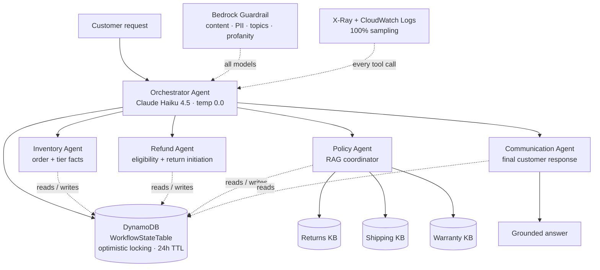
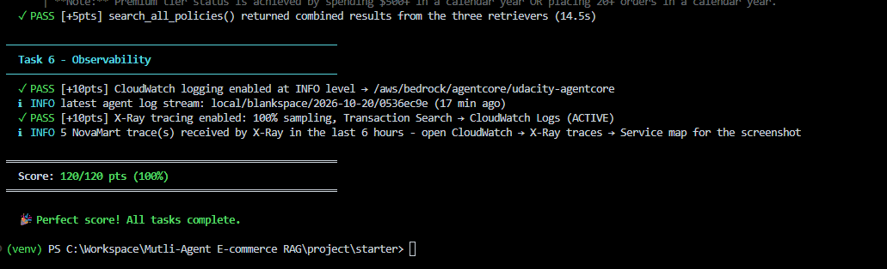

# NovaMart : Enterprise Multi-Agent Customer Support System

**Portfolio project · Amazon Bedrock AgentCore · Strands Agents SDK**
**Built October 2026 · Future AWS Agent Engineer Nanodegree capstone (Udacity + AWS) · passed capstone review**

> A routing agent reads each customer request and hands it to specialist workers. Order lookups hit DynamoDB, policy questions are answered from three knowledge bases queried in parallel, and a dedicated agent writes the final reply. Every step is traced in AWS X-Ray. The system passed all 120 points of the course evaluation suite.

I kept a [build journal](BUILD_JOURNAL.md) with what the course provided, what I wrote, and how the two build sessions went.


-2ea043)

---

## At a glance

| | |
|---|---|
| **Automated evaluation** | **120 / 120 pts (100%)** across Tasks 2–6 |
| **Agent topology** | 1 orchestrator + 4 worker agents + 3 parallel retriever sub-agents |
| **Grounding** | 3 Bedrock Knowledge Bases (returns, shipping, warranty) on S3 Vectors |
| **Scenarios** | Return request, policy question and pricing calculation, all run end to end |
| **Safety** | Versioned Bedrock Guardrail on every model invocation |
| **Observability** | 100% X-Ray sampling; orchestrator → worker service map in CloudWatch |
| **Deployment** | Amazon Bedrock AgentCore Runtime (PUBLIC / HTTP) |

---

## The problem

NovaMart's support team needs to answer order-status, return-eligibility and policy questions accurately. A single prompt can't reliably combine live order data, customer-tier rules, policy documents and safety constraints in one go.

**What I built:** a group of agents that share a versioned session record. A small, fast model routes the request; larger models work through the facts, refund rules and retrieved policy text; one agent writes the customer-facing reply. The workers stick to order data and retrieved policy passages instead of filling in gaps themselves.

## Architecture



**A few design choices**

- **Split routing from reasoning** — Haiku 4.5 at temperature 0.0 handles routing; Sonnet 4.5 does the reasoning, policy synthesis and reply writing.
- **Share state, not prompts** — each session has one DynamoDB record with a `version` field and conditional writes, so agents don't overwrite each other's work.
- **Fetch policies in parallel** — the policy agent runs three retrievers at once with `ThreadPoolExecutor(max_workers=3)` and synthesises their passages into one answer.
- **Guardrail at the model boundary** — one versioned Bedrock Guardrail (content, PII, denied topics, profanity) applies to all five agents.
- **Trace everything** — each routing tool call becomes an X-Ray subsegment, which gives a live map of the call chain.

More on the design and trade-offs in the [case study](docs/CASE_STUDY.md).

---

## What I built

The course provided the infrastructure stack, helper modules and test suite. I wrote the agent behaviour, deployed the runtime, configured the AWS-side resources, and ran the system end to end.

| Area | What I wrote | See it |
|---|---|---|
| **Agent behaviour** (Task 2) | The five agents, their tools and prompts, and the routing rules; session setup and the mandatory CommunicationAgent last step. | [Inventory](screenshots/scenario_tests_step_01.png) · [Refund](screenshots/scenario_tests_step_02.png) · [Reply](screenshots/scenario_tests_step_03_1.png) · [Policy](screenshots/scenario_tests_step_04_1.png) · [Math](screenshots/scenario_tests_step_06.png) |
| **Parallel RAG** (Task 5) | Three retriever sub-agents and `search_all_policies`; created and synced the three Knowledge Bases in the console and wired their IDs into `.env`. | [KB list](screenshots/knowledge_bases.png) · [Returns](screenshots/returns_kb.png) · [Shipping](screenshots/shipping_kb.png) · [Warranty](screenshots/warranty_kb.png) · [Parallel run](screenshots/test_agent_tests_03.png) |
| **Guardrails** (Task 3) | Created the guardrail (content, PII, denied topics, profanity) and published a numbered version for the runtime. | [CLI invocation](screenshots/agentcore_cli_test.png) · [Policy checks](screenshots/test_agent_tests_01.png) |
| **Deployment** (Task 3) | Wrote the runtime deployment function and environment wiring; deployed to AgentCore Runtime (PUBLIC / HTTP) via the CLI. | [Runtime invocation](screenshots/Script_test.png) · [Deploy checks](screenshots/test_agent_tests_01.png) |
| **Memory & observability** (Tasks 4 & 6) | Configured AgentCore Memory (session summaries, 7-day expiry), CloudWatch INFO logging and X-Ray at 100% sampling. | [Task 4 checks](screenshots/test_agent_tests_01.png) · [X-Ray map](screenshots/xray_service_map.png) |
| **Verification** | Ran the three scenarios, invoked the deployed runtime two ways, and ran the automated suite. | [Final test run](screenshots/test_agent_tests_04.png) |

The course-supplied pieces are listed in [Build Journal §1](BUILD_JOURNAL.md#1-what-was-expected--what-i-did) — mainly the CloudFormation stack, `config.py`, `seed_data.py`, the WorkflowState helpers, the trace and CLI helpers, and the tests.

### How the build went

Two sessions, 19–20 October 2026, reconstructed from file timestamps and AgentCore CLI logs: five deploys on the 19th, first invocation at 21:58. On the 20th, seeding at 19:51, three Knowledge Bases created and synced by 20:07, a few more deploys, two live invocations, the three scenarios from 20:42 to 20:56, the test suite from 21:00 to 21:21, and the X-Ray map at 21:33.

Step times from the terminal: Inventory **15.0 s**, Refund **15.9 s**, Communication **14.6 s** on the return flow; Policy **25.8 s** (including ~14 s of retrieval) and Communication **13.1 s** on the policy question; Communication **11.3 s** on the calculation. The calculation skipping three workers is where the routing pays off.

Full narrative and commands are in the [build journal](BUILD_JOURNAL.md). The screenshots are in [`screenshots/`](screenshots/), indexed in [docs/SCREENSHOTS.md](docs/SCREENSHOTS.md).

### What I'd change next time

- Latency is the main one: 11–26 s per worker step, and the return flow runs three in sequence (~45 s of worker time). I'd stream the reply and run independent steps concurrently.
- All three retrievers see `customer_tiers.txt`, so their answers overlap; one run had a 2-year vs 1-year warranty mismatch. I'd separate the source documents and have the coordinator reconcile conflicting passages.
- The refund agent approved the return but didn't call `initiate_refund` in that run, so the DynamoDB update never happened. I'd make that hand-off explicit.
- The reply rounded the discount before subtracting ($134.95); rounding the total gives $134.96. A stated rounding rule in the prompt fixes that.
- Live streamed text still interleaves during parallel retrieval, although the printed results after `[END]` came out clean.
- Things I haven't tried yet: guardrail blocks for the denied-topic examples, and memory recall across sessions.

Details in [Build Journal §5](BUILD_JOURNAL.md#5-observations-and-next-steps-i-recorded).

---

## Screenshots from the runs

<details>
<summary><b>Final test run — 120/120</b></summary>



</details>

<details>
<summary><b>X-Ray service map — the orchestrator and its workers</b></summary>


</details>

<details>
<summary><b>Policy answer from the deployed agent</b></summary>


</details>

<details>
<summary><b>Three retrievers answering one question in parallel (14.4 s)</b></summary>


</details>

---

## Tech stack

| Layer | Technologies |
|---|---|
| Language | Python 3.12, boto3 |
| Agent framework | Strands Agents SDK (`Agent`, `@tool`, BedrockModel) |
| Models | Claude Haiku 4.5 (routing), Claude Sonnet 4.5 (workers) |
| Agent platform | Amazon Bedrock AgentCore Runtime · Memory · Guardrails |
| Retrieval | Bedrock Knowledge Bases, S3 Vectors, Titan Embed Text v2 |
| Data | DynamoDB (orders, customers, workflow state), S3 (policy documents) |
| Infrastructure | CloudFormation, IAM, AgentCore CLI (direct code deployment) |
| Observability | CloudWatch Logs, AWS X-Ray, Transaction Search |

---

## Repository layout

```text
.
├── README.md                    # This file
├── BUILD_JOURNAL.md             # Build notes: plan vs. what I did, with timings
├── NovaMart_Build_Journal.pdf   # Original 13-page journal
├── .env.example                 # Configuration template
├── src/                         # Agent implementation
│   ├── agent_orchestrator.py    # Five agents, routing, guardrail, deployment
│   ├── config.py                # CloudFormation-backed configuration
│   ├── agent_observability.py   # X-Ray and CloudWatch instrumentation
│   ├── agent_utils.py           # Terminal trace UI
│   ├── agentcore_cli.py         # AgentCore CLI wrapper
│   ├── bedrock_kb_retrieval.py  # Knowledge Base retrieval helper
│   └── demo.py                  # Single end-to-end request
├── infrastructure/              # CloudFormation stack + data seeding
├── tests/                       # 120-point evaluation suite
├── diagrams/                    # Architecture and flow diagrams
├── screenshots/                 # 25 screenshots from the runs
├── docs/                        # Documentation hub (docs/README.md)
│   ├── CASE_STUDY.md            # Design and trade-offs
│   └── SCREENSHOTS.md           # Screenshot index
└── project/starter/             # Original course scaffold and local build cache
```

### Code to look at

- [`src/agent_orchestrator.py`](src/agent_orchestrator.py) — my implementation of the five agents, routing tools, guardrail creation and deployment pipeline.
- [`src/config.py`](src/config.py) — course-provided config that resolves resource IDs from CloudFormation exports and environment variables.
- [`infrastructure/stack.yaml`](infrastructure/stack.yaml) — infrastructure as code.
- [`tests/test_agent.py`](tests/test_agent.py) — the evaluation suite behind the 120/120 result.
- [`src/demo.py`](src/demo.py) — single-request local demo.

<details>
<summary><b>Run it locally (optional)</b></summary>

Requires AWS credentials and the infrastructure stack deployed. From the repository root:

```powershell
copy .env.example .env            # fill in your resource IDs
python -m venv .venv
.\.venv\Scripts\Activate.ps1
pip install -r requirements.txt

python infrastructure/seed_data.py
python src/agent_orchestrator.py test  # three traced scenarios
python src/agent_orchestrator.py chat  # interactive chat
python tests/test_agent.py all        # full 120-point evaluation
```

</details>

---

## Notes

- `.env` is git-ignored; [`.env.example`](.env.example) has placeholder names only.
- Original course materials are © Udacity and licensed under CC BY-NC-ND 4.0 — see [`LICENSE.md`](LICENSE.md). The agent implementation in `src/` is my capstone work; the original write-up is [`NovaMart_Build_Journal.pdf`](NovaMart_Build_Journal.pdf), with a searchable version in [`BUILD_JOURNAL.md`](BUILD_JOURNAL.md).

<!-- Replace the placeholders below with your own details before publishing. -->
**Built by Fredrick M. Morara** · [GitHub](https://github.com/your-username) · [LinkedIn](https://www.linkedin.com/in/your-profile)
