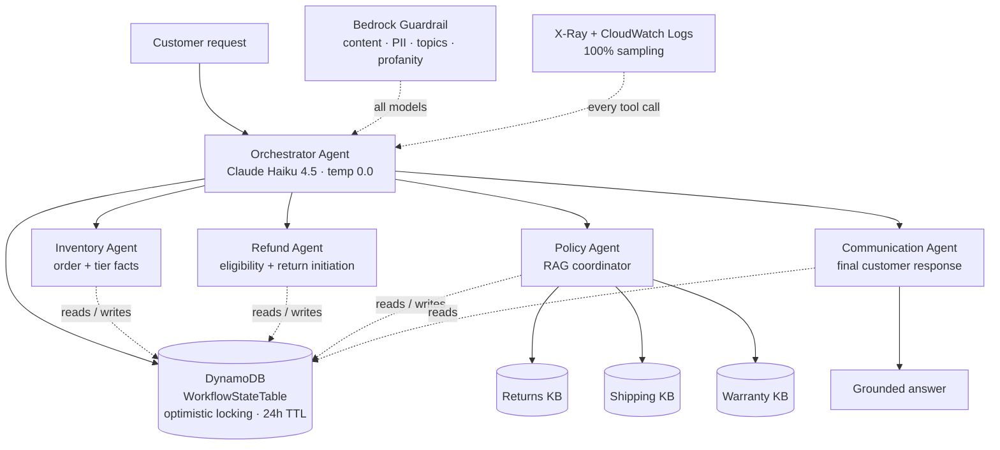
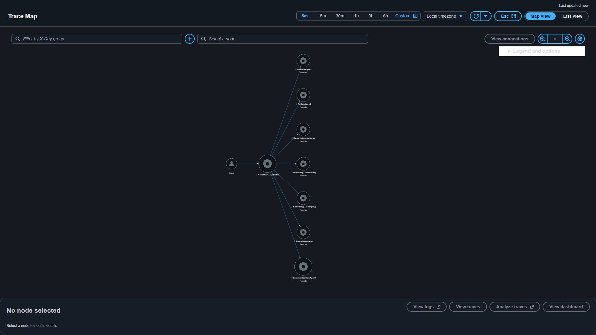
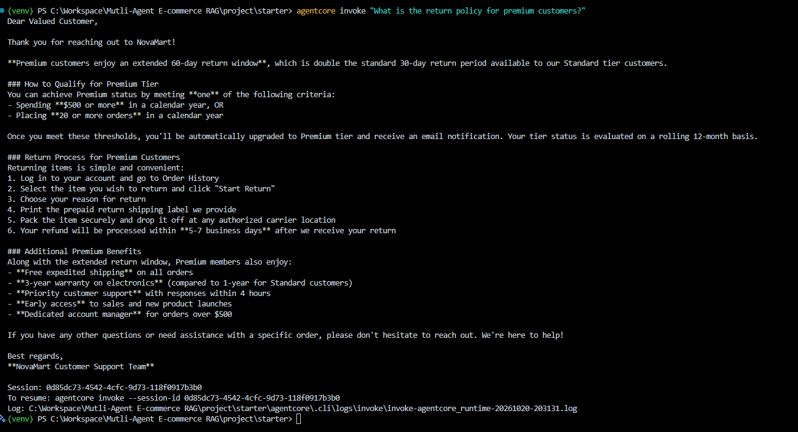
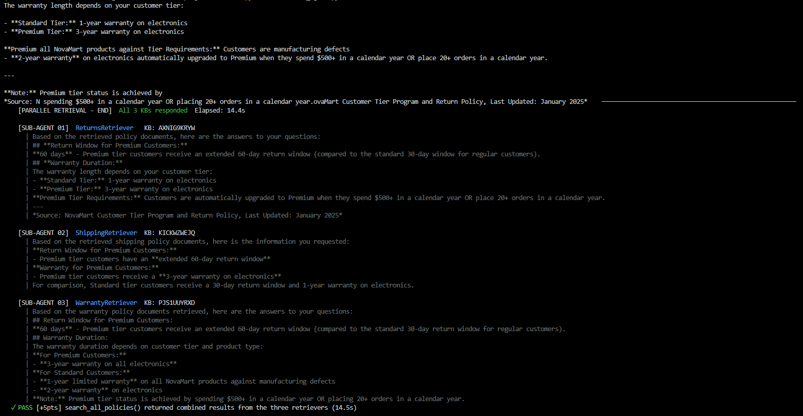

# NovaMart — Enterprise Multi-Agent Customer Support System

**Portfolio project · Amazon Bedrock AgentCore · Strands Agents SDK**
**Built October 2026 · Future AWS Agent Engineer Nanodegree capstone (Udacity + AWS) · passed capstone review**

> I designed and shipped a production-style customer support system where a fast routing agent delegates to specialised workers, policy answers are grounded in three independent RAG knowledge bases, and every request is traceable end to end in AWS X-Ray. The finished system scored **120/120 points (100%)** on the project's evaluation suite.

[**Read the build journal →**](BUILD_JOURNAL.md) — what the course expected, what I actually built and ran that day, and the limitations I recorded.


-2ea043)

---

## Results at a glance

| | |
|---|---|
| **Automated evaluation** | **120 / 120 pts (100%)** across Tasks 2–6 |
| **Agent topology** | 1 orchestrator + 4 worker agents + 3 parallel retriever sub-agents |
| **Grounding** | 3 Bedrock Knowledge Bases (returns, shipping, warranty) on S3 Vectors |
| **Scenarios verified** | Return request, policy question, and pricing calculation — all passed end to end |
| **Safety** | Versioned Bedrock Guardrail applied to every model invocation |
| **Observability** | 100% X-Ray sampling; full orchestrator → worker service map in CloudWatch |
| **Deployment** | Live Amazon Bedrock AgentCore Runtime (PUBLIC / HTTP) |

---

## The problem

NovaMart's support team needs to answer order-status, return-eligibility and policy questions accurately. A single prompt cannot reliably combine live order data, customer-tier rules, policy documents and corporate safety constraints in one shot.

**What I built:** a coordinated system of specialist agents that share a single, versioned session state. A cheap, fast model routes the work; more capable models reason over order facts, refund rules and retrieved policy text; a final agent composes the customer-facing answer. Nothing is invented — every claim is grounded in DynamoDB facts or retrieved policy passages.

## Architecture



**Design highlights**

- **Two-tier model strategy** — Claude Haiku 4.5 handles deterministic routing; Claude Sonnet 4.5 handles reasoning, policy synthesis and customer communication.
- **Shared state, not shared prompts** — one DynamoDB `WorkflowStateTable` record per session, with a `version` field and conditional writes (optimistic locking + retry) so agents never overwrite each other.
- **Parallel RAG** — the policy coordinator fans out to three retriever sub-agents concurrently with `ThreadPoolExecutor(max_workers=3)`, then synthesises their grounded passages into one answer.
- **Safety at the model boundary** — a versioned Bedrock Guardrail (content filters, PII blocking/anonymising, three DENY topics, profanity) is attached to all five agents.
- **Full traceability** — every routing tool call becomes an X-Ray subsegment, producing a live service map of the agent call chain.

Read the engineering rationale, trade-offs and hard problems in the **[Case Study](docs/CASE_STUDY.md)**.

---

## What I actually did

The course supplied the infrastructure, helper modules and test suite. **I built the behaviour, deployed it, configured the AWS-side resources, and produced the evidence.**

| Area | What I implemented | Evidence |
|---|---|---|
| **Agent behaviour** (Task 2) | The five agents, their tools, system prompts and routing rules; session init and the mandatory CommunicationAgent final step. | [Inventory](Submission/scenario_tests_step_01.png) · [Refund](Submission/scenario_tests_step_02.png) · [Reply](Submission/scenario_tests_step_03_1.png) · [Policy](Submission/scenario_tests_step_04_1.png) · [Math](Submission/scenario_tests_step_06.png) |
| **Parallel RAG** (Task 5) | Three retriever sub-agents and `search_all_policies`; created and synced the three Knowledge Bases in the console, wired their IDs into `.env`. | [KB list](Submission/knowledge_bases.png) · [Returns](Submission/returns_kb.png) · [Shipping](Submission/shipping_kb.png) · [Warranty](Submission/warranty_kb.png) · [Parallel run](Submission/test_agent_tests_03.png) |
| **Guardrails** (Task 3) | Created the guardrail (content, PII, denied topics, profanity) and published a numbered version used by the runtime. | [CLI invocation](Submission/agentcore_cli_test.png) · [Policy checks](Submission/test_agent_tests_01.png) |
| **Deployment** (Task 3) | Implemented the runtime deployment function and environment wiring; deployed to AgentCore Runtime (PUBLIC / HTTP) via the CLI. | [Runtime invocation](Submission/Script_test.png) · [Deploy checks](Submission/test_agent_tests_01.png) |
| **Memory & observability** (Tasks 4 & 6) | Configured AgentCore Memory (session summaries, 7-day expiry), CloudWatch INFO logging and X-Ray at 100% sampling. | [Task 4 checks](Submission/test_agent_tests_01.png) · [X-Ray map](Submission/xray_service_map.png) |
| **Verification** | Ran the three scripted scenarios, invoked the deployed runtime two ways, and ran the automated suite. | [120/120 score](Submission/test_agent_tests_04.png) |

**Provided by the course, not written by me:** the CloudFormation stack, `seed_data.py`, `cleanup.py`, `config.py`, the WorkflowState helpers with optimistic locking, `agent_utils.py`, `agent_observability.py`, `agentcore_cli.py`, `bedrock_kb_retrieval.py`, `demo.py`, and the automated test suite. The exact split is in [Build Journal §1](BUILD_JOURNAL.md#1-what-was-expected--what-i-did).

### What that day actually looked like

Two build sessions, 19–20 October 2026. Reconstructed from screenshot timestamps and AgentCore CLI logs: deployment iterations on the 19th (five deploys, first invocation at 21:58); on the 20th — seeding at 19:51, Knowledge Bases created and synced by 20:07, three more deploys, two live invocations, all three scenarios between 20:42 and 20:56, the test suite from 21:00 to 21:21, and the X-Ray map at 21:33.

Measured step times: Inventory **15.0 s**, Refund **15.9 s**, Communication **14.6 s** on the return flow; Policy **25.8 s** (including ~14 s of parallel retrieval) and Communication **13.1 s** on the policy question; Communication **11.3 s** on the calculation. The calculation skipping three workers is the clearest example of routing paying off.

Full narrative, commands and figure mapping: **[Build Journal](BUILD_JOURNAL.md)**. Screenshots live in [`Submission/`](Submission/) and are catalogued in the **[Evidence Index](docs/EVIDENCE.md)** — proof of work, not step-by-step documentation.

### What I observed and would improve

I recorded these limits rather than claiming more than the evidence shows:

- Worker latency is 11–26 s per step; the three-worker return chain is ~45 s of worker time. Streaming and concurrent independent steps would come first.
- Live parallel output still interleaves in the terminal, although the printed results after `[END]` were clean.
- `customer_tiers.txt` sits under all three S3 prefixes, so retrievers overlap and one run showed a conflicting 2-year vs 1-year warranty figure.
- The refund agent approved the return but did **not** call `initiate_refund` in the captured run, so the record update was not exercised.
- The reply reports **$134.95** by rounding the discount before subtracting; rounding the total instead gives $134.96.
- Not captured, therefore not claimed: guardrail blocks for the blocked-topic examples, memory recall across sessions, and (in the journal figures) the Task 6 test output.

Details in [Build Journal §5](BUILD_JOURNAL.md#5-observations-and-next-steps-i-recorded).

---

## Selected evidence

<details>
<summary><b>120/120 on the full evaluation suite (Tasks 2–6)</b></summary>


</details>

<details>
<summary><b>Live X-Ray service map — orchestrator calling every worker and retriever</b></summary>



</details>

<details>
<summary><b>Live deployed agent answering a policy question with grounded content</b></summary>



</details>

<details>
<summary><b>Three parallel retrievers answering one policy question in 14.4s</b></summary>



</details>

---

## Tech stack

| Layer | Technologies |
|---|---|
| Language | Python 3.12, boto3 |
| Agent framework | Strands Agents SDK (`Agent`, `@tool`, BedrockModel) |
| Models | Claude Haiku 4.5 (routing), Claude Sonnet 4.5 (workers) |
| Agent platform | Amazon Bedrock AgentCore Runtime · Memory · Guardrails |
| Retrieval | Bedrock Knowledge Bases, S3 Vectors, Titan Embed Text v2 |
| Data | DynamoDB (orders, customers, workflow state), S3 (policy documents) |
| Infrastructure | CloudFormation, IAM, AgentCore CLI (direct code deployment) |
| Observability | CloudWatch Logs, AWS X-Ray, Transaction Search |

---

## Repository map

```text
.
├── README.md                    # Portfolio landing page (this file)
├── BUILD_JOURNAL.md             # Expected vs. what I actually built and ran that day
├── NovaMart_Build_Journal.pdf   # Original 13-page build journal (source document)
├── docs/                        # Documentation hub (docs/README.md)
│   ├── CASE_STUDY.md            # Architecture, decisions, trade-offs, next steps
│   └── EVIDENCE.md              # Screenshot index + journal figure mapping
├── project/starter/             # Original project scaffold + delivered work
│   ├── src/                     # Agent implementation, CLI, retrieval, tracing
│   ├── infrastructure/          # CloudFormation stack + data seeding
│   ├── tests/                   # 120-point evaluation suite
│   ├── diagrams/                # Architecture and flow diagrams
│   └── agentcore/               # AgentCore CLI project + build artefacts
└── Submission/                  # Completed agent code + screenshot evidence
    ├── agent_orchestrator.py    # Five-agent system, deployment pipeline
    ├── config.py                # Lazy, CloudFormation-backed configuration
    └── *.png                    # 25 evidence screenshots (see docs/EVIDENCE.md)
```

### Key files

- [`Submission/agent_orchestrator.py`](Submission/agent_orchestrator.py) — *my implementation*: all five agents, routing tools, guardrail creation and the deployment pipeline.
- [`Submission/config.py`](Submission/config.py) — *provided by the course*: lazy, cached resolution of AWS resource IDs from CloudFormation exports and environment variables.
- [`project/starter/infrastructure/starter_stack.yaml`](project/starter/infrastructure/starter_stack.yaml) — infrastructure as code.
- [`project/starter/tests/test_agent.py`](project/starter/tests/test_agent.py) — the evaluation suite that produced the 120/120 result.
- [`project/starter/src/demo.py`](project/starter/src/demo.py) — single-request local demo.

<details>
<summary><b>Run it locally (optional)</b></summary>

Requires AWS credentials and the infrastructure stack deployed. From the repository root:

```powershell
copy Submission\.env.example .env     # fill in your resource IDs
python -m venv .venv
.\.venv\Scripts\Activate.ps1
pip install -r requirements.txt

cd project\starter
python infrastructure/seed_data.py
python src/agent_orchestrator.py test  # three traced scenarios
python src/agent_orchestrator.py chat  # interactive chat
python tests/test_agent.py all        # full 120-point evaluation
```

</details>

---

## Notes

- `.env` is git-ignored; [`Submission/.env.example`](Submission/.env.example) contains placeholder names only — no credentials or resource IDs are committed.
- Original course materials are © Udacity and licensed under CC BY-NC-ND 4.0 — see [`LICENSE.md`](LICENSE.md). The agent implementation in `Submission/` is my capstone work; the source narrative is [`NovaMart_Build_Journal.pdf`](NovaMart_Build_Journal.pdf) and its searchable version is [`BUILD_JOURNAL.md`](BUILD_JOURNAL.md).

<!-- Replace the placeholders below with your own details before publishing. -->
**Built by [Your Name]** · [GitHub](https://github.com/your-username) · [LinkedIn](https://www.linkedin.com/in/your-profile)
