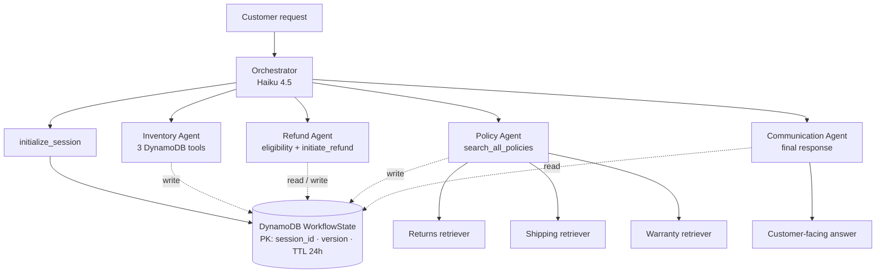

# Case Study — NovaMart Multi-Agent Customer Support System

A deeper look at the system behind the [portfolio README](../README.md): what I was asked to build, how I designed it, what I actually ran, and how I verified the result. For the day-by-day account, see the [Build Journal](../BUILD_JOURNAL.md).

---

## 1. Brief

NovaMart needed a support system that could handle three very different kinds of customer request with one entry point:

1. **Order / return requests** — look up live order and customer data, apply tier-specific return windows, and actually initiate a return when eligible.
2. **Policy questions** — answer from official returns, shipping and warranty documents, without inventing policy.
3. **General calculations** — handle pricing arithmetic correctly without treating it as a policy violation.

Every request had to be safe (guardrailed), stateful (a session's findings must be shared between agents), and observable (we need to see which agent did what, in production).

Constraint: use **Strands Agents SDK** for the agent loop and deploy on **Amazon Bedrock AgentCore**.

## 2. Architecture and why I chose it

### Decision 1 — Separate "routing" from "reasoning"

The orchestrator runs on **Claude Haiku 4.5** at temperature 0: it only decides *which* workers to call and in what order. Workers run on **Claude Sonnet 4.5** with low, task-specific temperatures (0.0–0.3). This keeps routing cheap and deterministic while reserving reasoning capacity for eligibility decisions and response composition.

It also makes behaviour testable: the evaluation suite can assert that the orchestrator uses `ORCHESTRATOR_MODEL_ID` and every worker uses `WORKER_MODEL_ID`.

### Decision 2 — Shared state instead of a giant prompt

Each session gets one `WorkflowStateTable` item:

| Field | Written by | Purpose |
|---|---|---|
| `session_id`, `customer_id`, `created_at` | Orchestrator | Session identity |
| `version` | Every write | Optimistic lock |
| `ttl` | Orchestrator | Auto-expiry after 24 h |
| `inventory_agent` | Inventory route | Order facts + customer tier |
| `policy_agent` | Policy route | Synthesised policy text |
| `refund_agent` | Refund route | Decision + return reference |
| `communication_agent` | Communication route | Final response draft |

Workers never see each other's prompts; they read and update structured state. The refund agent, for example, calls `get_inventory_context(session_id)` rather than trusting text passed along the chain.

**Trade-off:** one DynamoDB item per session is a write hotspot under high concurrency. The course-provided WorkflowState helpers use conditional updates (`version = :expected_version`) plus a three-attempt retry loop with a fresh read; my agents use that contract on every route. In the captured return run the state moved `0 → 1 → 2 → 3` as each agent wrote its field. A high-throughput redesign would move to per-agent items or an event store.

### Decision 3 — Multi-agent RAG with parallel fan-out

The policy agent owns three specialised retriever sub-agents, each with exactly one tool pointed at one knowledge base. `search_all_policies()` submits all three through a `ThreadPoolExecutor(max_workers=3)` and collects results with `as_completed()`.

Why three small retrievers instead of one agent with three tools? Each sub-agent has a tightly scoped system prompt ("report only the factual policy text found"), which reduces cross-domain confusion. The coordinator then synthesises the combined passages and is explicitly told never to invent policy.

The knowledge bases are **vector RAG** stores backed by S3 Vectors (1024 dimensions, cosine distance) using Titan Embed Text v2 — the same configuration the evaluation suite checks.

### Decision 4 — Guardrail at the model boundary

I created one **versioned Bedrock Guardrail** and attached it to every agent's `BedrockModel` via `model.update_config(...)` (a course-provided helper applies the config). Enforcement then happens per invocation, regardless of which agent is running:

- **Content filters:** SEXUAL / VIOLENCE / HATE at HIGH; INSULTS / MISCONDUCT at MEDIUM.
- **PII:** credit-card numbers and SSNs BLOCKed; email and phone ANONYMIsed.
- **Denied topics:** competitor products, pricing negotiations, legal threats.
- **Word policy:** managed PROFANITY list.
- Custom blocked-input / blocked-output messaging.

The **denied-topic boundary matters**: "pricing negotiations" is defined as haggling or changing an advertised price, and explicitly allows arithmetic that applies a stated discount. Without that boundary an ordinary question such as *"5 items at $29.99 with 10% off?"* could be blocked. The calculation scenario passes through the guardrail and is answered ([run](../screenshots/scenario_tests_step_06.png)).

### Decision 5 — Deploy the real agent, not a notebook

The runtime is deployed as **direct code deployment** through the AgentCore CLI: the orchestrator file and its helper modules are staged into `build/runtime/` with a `pyproject.toml` of arm64/Python 3.12 wheels, then packaged and deployed via CDK. Re-deployment is idempotent — an unchanged runtime is left alone. Environment variables carry the KB IDs, guardrail ID/version and log group into the runtime.

## 3. Implementation walkthrough

| Task | Mine | Provided by the course | Entry points |
|---|---|---|---|
| **2 — Orchestration** | `build_inventory_agent`, `build_refund_agent`, `build_policy_agent`, `build_communication_agent`, `build_orchestrator_agent`, `build_agent_graph`; all routing rules and prompts | WorkflowState helpers with optimistic locking; `agent_utils.py` trace UI | [`agent_orchestrator.py`](../src/agent_orchestrator.py) |
| **3 — Guardrails + deployment** | `create_guardrail` (create → publish version), `deploy_to_agentcore_runtime`, runtime environment wiring | `agentcore_cli.py` wrapper | [`agent_orchestrator.py`](../src/agent_orchestrator.py) |
| **4 — Memory** | `configure_memory` — `SESSION_SUMMARY` strategy, 7-day event expiry | — | `configure_memory()` |
| **5 — Knowledge Bases** | Three retriever sub-agents; concurrent `search_all_policies`; KB creation/sync in the console + `.env` wiring | `bedrock_kb_retrieval.py` retrieval client | [`bedrock_kb_retrieval.py`](../src/bedrock_kb_retrieval.py) |
| **6 — Observability** | CloudWatch INFO logging and X-Ray 100% sampling configuration | `@tool` X-Ray wrapper in `agent_observability.py` | [`agent_observability.py`](../src/agent_observability.py) |
| **Config & infra** | `.env` wiring and deployed resource IDs | Lazy config from CloudFormation exports; CloudFormation stack; `seed_data.py`, `cleanup.py`; automated test suite | [`config.py`](../src/config.py), [`stack.yaml`](../infrastructure/stack.yaml), [`seed_data.py`](../infrastructure/seed_data.py) |

### Request lifecycle (return request)

1. Orchestrator calls `initialize_session(session_id, customer_id)`.
2. `route_to_inventory_agent` → `check_order_status`, `get_customer_tier` → writes facts to state.
3. `route_to_refund_agent` → reads inventory context, applies the 30/60-day tier window, writes the decision to state.
4. `route_to_communication_agent` → reads the full state and writes the final empathetic, grounded response.
5. Every tool call is recorded as an X-Ray subsegment under `NovaMart-Orchestrator`.

The terminal trace in [`scenario_tests_step_01.png`](../screenshots/scenario_tests_step_01.png) → [`scenario_tests_step_03_1.png`](../screenshots/scenario_tests_step_03_1.png) shows the sequence, including state versions incrementing `0 → 1 → 2 → 3`.

**Important caveat:** in the captured run the RefundAgent approved the return and asked the customer for a reason, but did **not** call `initiate_refund`. The approval-to-record-update hand-off therefore never happened in that run. See [Build Journal §5](../BUILD_JOURNAL.md#5-observations-and-next-steps-i-recorded).

## 4. Engineering details and trade-offs

**1. The guardrail topic boundary.**
The `PricingNegotiations` deny topic is deliberately defined as haggling or changing an advertised price, and explicitly excludes arithmetic applying a stated discount. The `STANDARD` topic tier and cross-region guardrail profile are used, and the guardrail is published as a numbered version (not DRAFT) before the runtime is pointed at it. This is what lets the calculation scenario pass while genuine negotiation stays blocked.

**2. Parallel retrieval output is only partly tamed.**
The Strands SDK streams output from internal threads, so three concurrent retrievers interleave in the live terminal view. The course-provided trace helper suppresses sub-agent output during the parallel step, and my coordinator returns each retriever's text as a value so results can be printed cleanly and sequentially after the `[END]` marker. The clean printed results and final answers were unaffected, but the live view still mixes streamed text ([run](../screenshots/scenario_tests_step_04_2.png)). I did not fully solve this.

**3. Concurrent state writes are safe by contract.**
The course-provided WorkflowState helpers use conditional DynamoDB updates with a `version` counter and retry-on-conflict. My routing tools read the current version before invoking a worker and pass it to the update, so no read-modify-write can silently overwrite another agent's field.

**4. Imports work without AWS credentials.**
The course-provided `config.py` resolves resource IDs lazily (PEP 562 module `__getattr__`), caching CloudFormation exports on first use. My local and deployed code share this module, so importing it, running linters or instantiating agents never makes an AWS call — only actual resource access does. Each failure mode (no credentials, stack missing, export missing) has its own clear error message.

## 5. Verification and results

I verified at two levels.

**End-to-end scenarios** (`python src/agent_orchestrator.py test`):

| Scenario | Path | Result | Observed step times |
|---|---|---|---|
| Return request (Premium, in-window) | Orchestrator → Inventory → Refund → Communication | Approved; $149.99 refund explained. `initiate_refund` was **not** called in the captured run | Inventory 15.0 s · Refund 15.9 s · Communication 14.6 s |
| Policy question | Orchestrator → Policy (3 KBs in parallel) → Communication | Grounded answer citing the 60-day Premium window; retriever outputs partly overlapped | Policy 25.8 s (incl. ~14 s retrieval) · Communication 13.1 s |
| Pricing calculation | Orchestrator → Communication | 5 × $29.99 − 10% = **$134.95** (discount rounded first; rounding the total gives $134.96) | Communication 11.3 s |

**Automated evaluation** (`python tests/test_agent.py all`) — checks read real AWS state; nothing is mocked:

| Task | Checks include | Result |
|---|---|---|
| 2 | Agent instantiation, tool counts, correct model tiers, ThreadPoolExecutor fan-out | Pass |
| 3 | Guardrail existence + exact policies, published version, READY runtime with env wiring | Pass |
| 4 | Memory ACTIVE, summary strategy, 7-day expiry | Pass |
| 5 | Three ACTIVE KBs with Titan embeddings + completed syncs, parallel retrieval returns results | Pass |
| 6 | CloudWatch INFO logging, X-Ray 100% sampling, Transaction Search, traces received | Pass |
| **Total** | | **120 / 120 (100%)** |

The build journal describes 30 checks across Tasks 2–5; the final screenshot retained in `screenshots/` shows the Task 6 observability checks as well and the 120/120 score. The difference is in what was captured in each account, not in the outcome.

See [`test_agent_tests_04.png`](../screenshots/test_agent_tests_04.png), the [Build Journal](../BUILD_JOURNAL.md) and the full [screenshot index](SCREENSHOTS.md).

## 6. What I'd do next

From the build journal, in priority order:

- **Stream the reply and run independent steps concurrently.** Worker latency is 11–26 s and the return chain runs three workers sequentially (~45 s of worker time).
- **Clean the retrieval sources and reconcile conflicts.** `customer_tiers.txt` under all three prefixes makes retrievers overlap; one run showed a 2-year vs 1-year warranty conflict. Separate the documents and make the coordinator resolve contradictions explicitly.
- **Make approval → record update explicit.** A prompt change or confirmation step so `initiate_refund` is actually called after approval.
- **State a rounding rule in the prompt.** Rounding the discount first gives $134.95; rounding the total gives $134.96.
- Also worth adding: a guardrail evaluation set for the denied-topic examples, mocked unit tests for routing and tier boundaries, and a per-agent cost/latency dashboard using the existing logs.

## 7. Credits

Built in October 2026 as the capstone project for the **Future AWS Agent Engineer Nanodegree (Udacity + AWS)** and passed the capstone review. Original course materials are © Udacity, CC BY-NC-ND 4.0 ([LICENSE](../LICENSE.md)); the agent implementation in `src/` and the screenshots in `screenshots/` are my completed work. Source narrative: [`NovaMart_Build_Journal.pdf`](../NovaMart_Build_Journal.pdf).
